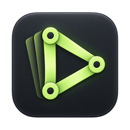
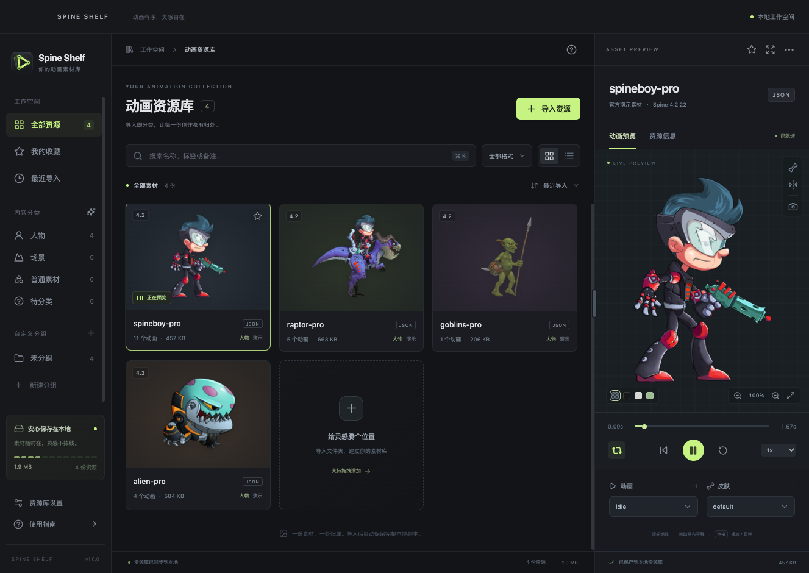

<p align="center">
  
</p>

# Spine Shelf

**把 Spine 动画整理成一个可以随时浏览的本地素材库。**

中文桌面端 Spine 动画资源管理与预览工具。导入整个文件夹，自动识别骨骼、图集和图片，在本地保存、分类、搜索与预览，无需每次重新打开文件。

[下载 v1.4.0](https://github.com/myricaRuba/spine-shelf/releases/tag/v1.4.0) · [更新记录](CHANGELOG.md) · [反馈问题](https://github.com/myricaRuba/spine-shelf/issues) · [参与贡献](CONTRIBUTING.md)



_截图使用 Esoteric Software 官方演示素材。_

## v1 功能

以下包含最新源码功能；已发布安装包的内容以对应版本的更新记录为准。

- **文件夹导入**：递归扫描子文件夹，识别 JSON / SKEL / SKEL.BYTES，配对 ATLAS 和多页贴图，重复内容自动跳过。
- **持久资源库**：保存完整本地副本，原始目录移动后仍可浏览；收藏、分组、标签和备注在重启后保留。
- **内容分类**：自动整理为人物、场景、普通素材和待分类，支持手动修正，与自定义项目分组互相独立。
- **动画预览**：选择动画和皮肤，播放、暂停、循环、调速、拖动时间轴、缩放、平移、水平翻转和显示骨骼。
- **截图导出**：将当前帧保存为透明 PNG。
- **浏览与整理**：搜索、格式筛选、排序、网格/列表切换；后台依次生成静态缩略图。
- **可调预览区**：拖动左边界调整宽度并自动记忆，双击恢复默认；悬停图标查看中文说明。
- **AI 换肤**：在资源信息中填写要求，直接调用本机 Codex 制作，通过 MCP 将结果加入当前角色的皮肤列表；支持删除新增皮肤、修改要求重新设计，以及查看制作详情。重新设计成功后替换同名皮肤，失败时保留旧结果。
- **AI 制作 Spine**：输入角色需求和动作表，由 Codex 生成透明部件与骨骼动画，支持加权网格、IK 和缓动，可在导入前预览检查动作与骨骼网格。通过 MCP 校验后加入资源库，输出 Spine 4.2，详见 [制作 MCP 说明](docs/generation-mcp.md)。
- **游戏项目（v1.4.0）**：从资源库批量挑选素材，按人物、地形等分类整理；同一素材可用于多个项目，分别设置名称、分类、用途与导出皮肤。
- **项目导出**：选择全部或指定素材，按分类导出 ZIP，包含骨骼、图集、贴图和资源清单。默认合并原版与全部新增皮肤，支持运行时切换；也可仅导出当前外观。需要版本转换时调用本机 Spine 编辑器并校验输出。
- **离线浏览**：导入、预览和分类均在本机完成；AI 换肤的图片生成由用户的 Codex 会话执行，需要相应的联网模型能力。

## 下载与安装

当前版本 **v1.4.0**，在 [Releases](https://github.com/myricaRuba/spine-shelf/releases/latest) 选择对应安装包：

| 系统 / 处理器 | 安装包 | 安装方式 |
| --- | --- | --- |
| **Windows 11 · Intel / AMD（x64）** | `Spine-Shelf-1.4.0-Windows-x64-Setup.exe` | 双击安装，可选择目录，默认安装给当前用户 |
| **Windows 11 · ARM（如 Snapdragon）** | `Spine-Shelf-1.4.0-Windows-arm64-Setup.exe` | 双击安装，使用原生 ARM64 版本 |
| **macOS · Apple Silicon（M 系列）** | `Spine-Shelf-1.4.0-macOS-arm64.dmg` | 打开后拖入「应用程序」 |

安装完成后，从桌面或开始菜单启动，导入文件夹或将文件夹拖入窗口。Windows 保留原生最小化、最大化和关闭按钮，快捷键显示为 Ctrl，并通过文件资源管理器打开资源库。卸载程序保留用户资源库。

安装包暂未购买代码签名证书：Windows 首次运行可能显示「未知发布者」或 SmartScreen 提示；macOS 包尚未经过 Developer ID 签名或公证。请核对下载仓库和 Release 附带的 `SHA256SUMS.txt`。macOS 阻止首次打开时，可在「系统设置 → 隐私与安全性」允许打开。

自动化验证环境为 Windows Server 2025 x64、Windows 11 ARM64 和 macOS Apple Silicon，包含安装后的动画渲染与重启持久化。普通 Intel / AMD Windows 11 实机的显卡和显示缩放组合尚未逐一验证。Intel Mac 暂无安装包。

## 支持的素材

| 项目                              | 支持情况                                          |
| --------------------------------- | ------------------------------------------------- |
| Spine 导出版本                    | 3.6、3.8、4.0、4.1、4.2、4.3；按素材版本选择本地运行库 |
| 骨骼数据                          | JSON、SKEL，以及以 `.skel.bytes` 命名的二进制数据 |
| 纹理                              | `.atlas` 引用的常规图片，支持多页图集             |
| `.spine` 工程                     | 需先在 Spine 编辑器中导出，不能直接预览工程文件   |
| ZIP 直接导入 / 加密数据 / 游戏专有压缩纹理 | 暂不支持；项目 ZIP 请先解压再导入             |

`3.6`（含 `3.6.53`）支持直接导入 JSON 或 SKEL，与 atlas、贴图一起预览。软件自动生成同版本的内部预览缓存，原始 SKEL 保持不变，无需 Spine 编辑器。`.spine` 编辑器工程仍需配套导出数据。

`3.8.75` JSON 使用本地兼容补丁读取；该版本的二进制 SKEL 仍需在 Spine 编辑器中重新导出。补丁保留原 JSON 版本信息和骨骼、动画数据。

建议的目录结构：

```text
角色素材/
  character.json      # 或 character.skel
  character.atlas
  character.png
```

导入器优先选择同目录同名图集，允许 `-pro` / `-ess` / `-pma` 等命名差异；只有一个图集时可以自动配对。多个候选无法明确匹配时会给出提示。重复检测比较骨骼、图集和图片的完整内容。

首次启动会加入四份标记为「演示」的官方示例；可以移除，也可从导入窗口重新加载。

## 在同一角色中添加 AI 皮肤

**v1.3.2** 支持直接调用 Codex，并在任务的「制作详情」中查看进度与操作记录。需要本机可用的新版 Codex 与 ChatGPT 登录；真实模型调用已在 macOS Apple Silicon 验证，Windows 的真实 Codex 换肤流程尚未验证。

1. 选择角色，进入右侧「资源信息 → AI 换肤」。
2. 选择基础皮肤，填写新皮肤名称与换肤要求，点击「开始制作」。
3. 软件自动调用本机已登录的 Codex，显示制作进度；制作期间保持 Spine Shelf 打开。
4. 完成后点击「查看皮肤」，或在「动画预览 → 皮肤」中切换。角色条目、骨骼和动画保持原样。

任务会保存进度，支持取消和失败后重试。MCP 负责读取当前角色、回报进度和校验写回；重绘使用 Codex 的图片生成能力。连接方式、工具与数据格式见 [换肤 MCP 说明](docs/reskin-mcp.md)。

生成结果需要调整时，在动画预览的皮肤下拉框下方点击「重新设计皮肤」，修改要求并选择从原版重画或基于当前皮肤修正。也可点击「删除皮肤」移除新增外观，项目引用自动切回基础皮肤；原始皮肤保留，旧贴图归档到本地备份。

## 创建游戏项目并导出素材包

v1.4.0 新增项目整理功能：

1. 在左侧「游戏项目」点击 **+**，填写名称创建项目。
2. 点击「添加素材」，搜索并批量勾选资源；也可以在资源库卡片或资源信息中点击「加入项目」。
3. 点击项目内素材卡片底部的分类/皮肤，设置项目内名称、分类、用途备注和导出皮肤。分类栏显示数量，项目设置支持新增、改名和删除空分类。
4. 点击「导出项目」，选择全部或按需勾选素材、目标 Spine 版本和皮肤导出方式，再选择 ZIP 保存位置。
5. 解压后将需要的分类文件夹加入游戏工程，使用清单中的运行时皮肤名与匹配的 Spine 运行库。

项目只引用资源库条目。移出素材或删除项目不会删除库中素材；同一素材在不同项目中的分类、名字和皮肤互不影响。正在被项目使用的库内素材需要先移出项目才能删除。

导出包包含 `project.json`、`资源清单.csv`、`SHA256SUMS.txt` 和使用说明。默认「可切换皮肤」把原版与全部新增皮肤合并到同一份骨骼数据中；「仅当前皮肤」把所选外观固化到贴图。SKEL 合并新增皮肤时需要本机 Spine 转为 JSON，版本转换也需要可正常导出的 Spine 编辑器。完整目录与字段见 [项目导出说明](docs/project-export.md)。ZIP 需先解压再导入 Spine Shelf。

## 自动分类如何工作

分类使用本地规则，综合骨骼、插槽、附件、动画、图集区域及素材名称。例如，肢体骨骼与跑步、攻击动作可作为人物线索；天空、地面、建筑图层可作为场景线索；边框、文字、按钮等名称可作为普通素材线索。

**这不是视觉 AI 分类。** 如果内部名称也都是编号或信息冲突，素材会进入「待分类」。SKEL 素材先使用图集和二进制名称线索，预览或缩略图解码后再用准确元数据补充分类。

在「资源信息 → 内容分类」中手动修正后，自动处理不会覆盖该结果。点击「恢复自动分类」解除锁定。左侧分类标题旁的按钮可重新整理整个库。

## 操作与快捷键

| 操作                | 用途                                   |
| ------------------- | -------------------------------------- |
| `⌘/Ctrl + O`        | 导入资源                               |
| `⌘/Ctrl + K`        | 搜索资源                               |
| `空格`              | 播放 / 暂停（焦点不在输入控件时）      |
| `F`                 | 适应画布                               |
| 鼠标滚轮 / 拖动画布 | 缩放 / 平移                            |
| 拖动预览左边界      | 调整并记住宽度                         |
| 双击预览左边界      | 恢复默认宽度                           |
| `Esc`               | 关闭弹窗、退出大预览或取消当前宽度拖动 |

分隔线也支持键盘：Tab 聚焦后用左右方向键调节，Shift 加速，Enter 恢复默认。按钮可通过 Tab 聚焦查看提示。

## 数据与备份

在「资源库设置」中查看实际存储位置。默认根目录：

- Windows：`%APPDATA%\Spine Shelf\Library\`
- macOS：`~/Library/Application Support/Spine Shelf/Library/`

目录内部结构相同，可退出应用后将整个 `Library` 文件夹复制到另一台电脑或另一个系统：

```text
Library/
  library.json         # 素材索引、游戏项目、分类、分组、收藏、标签和备注
  library.json.bak     # 上一次成功写入前的索引备份
  assets/<uuid>/       # 每份素材的完整副本和缩略图
  .trash/<uuid>/       # 从库中移除的素材副本
```

退出应用后，复制整个 `Library` 文件夹即可备份。恢复时替换同名目录。索引原子写入，损坏索引不会被静默清空。移除素材不删除原始文件，库内副本暂存于 `.trash`。

仓库中只包含代码、品牌资源和官方演示素材，不包含用户导入的个人素材库。

## 本地开发

推荐 Node.js 24（最低 22.12）。

```sh
git clone https://github.com/myricaRuba/spine-shelf.git
cd spine-shelf
npm ci
npm run dev
```

`npm run dev` 会同时启动 Vite 和 Electron；仅在浏览器中打开页面无法使用本地资源库功能。

```sh
npm test                    # 导入、索引、分类、去重、迁移与持久化
npm run build               # TypeScript 检查和生产构建
npm run test:e2e            # Electron 真实预览、交互和重启
npm run test:classification # 分类筛选与手动修正
npm run test:layout         # 面板调宽、宽度记忆和按钮提示
npm run test:compat         # 5 个版本 × JSON/SKEL 的实际像素渲染
npm run test:reskin         # MCP 回写、原皮肤像素与重启持久化
npm run test:codex          # 点击开始 → 后台进程 → MCP 回写（测试进程，无模型调用）
npm run test:projects       # 项目分类、批量加入、ZIP 导出、重导入像素与重启持久化
npm run package            # 本机架构 macOS .app
npm run dist:mac           # macOS DMG
npm run dist:win           # Windows x64 NSIS 安装包，在 Windows 上构建
npm run dist:win:arm64     # Windows ARM64 NSIS 安装包
npm run build:icons        # 在 macOS 从 Logo 母版生成 PNG、ICNS、ICO
```

桌面测试需要图形环境并使用独立临时资源库，不修改用户数据。兼容性测试首次运行会从官方 GitHub 下载素材至 `test-results/fixtures`。`SPINE_SHELF_DATA` 可指定独立用户数据目录。常规 CI 在 Linux 和 Windows 执行单元测试与生产构建；`Desktop packages` 工作流在 Windows x64、Windows 11 ARM64 和 macOS 上构建并验证安装包，可手动触发生成 Release 草稿。

## 项目结构

```text
electron/     原生窗口、文件导入、本地索引、分类规则和受限 IPC
src/          React 界面、预览引擎和面板交互
public/       界面标识与旧版运行库
resources/    应用图标、Logo 母版及官方示例
licenses/     第三方完整许可文本
tests/        导入与分类测试
scripts/      开发、图标构建和桌面验证脚本
```

界面使用 React、TypeScript 和 Vite，桌面层使用 Electron。不同 Spine 运行库按需加载。渲染进程启用沙盒与上下文隔离；本地文件通过限定于应用和资源库目录的 `shelf://` 协议提供。

## 许可与致谢

**自写代码和项目文档采用 [MIT](LICENSE) 许可。Spine 官方运行库及示例素材保留各自许可，不属于 MIT 授权范围。**

使用、修改或分发包含 Spine Runtimes 的完整应用时，须同时遵守 [Spine Runtimes License Agreement](https://esotericsoftware.com/spine-runtimes-license) 和适用的 [Spine Editor License Agreement](https://esotericsoftware.com/spine-editor-license)。本项目的 MIT 许可不能免除上游许可证要求。详见 [第三方声明](THIRD_PARTY_NOTICES.md)，其中列出组件版本、来源和完整许可文件。

感谢 [Esoteric Software / spine-runtimes](https://github.com/EsotericSoftware/spine-runtimes)、Electron、React 和 Lucide。Spine Shelf 是独立项目，与 Esoteric Software 无隶属或背书关系。

新 Logo 由内置 imagegen 生成，[母版](resources/brand/spine-shelf-logo-master.png)与[生成提示词](resources/brand/generation-prompt.txt)一并提供。
